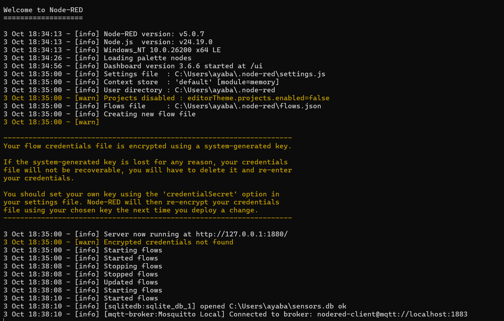
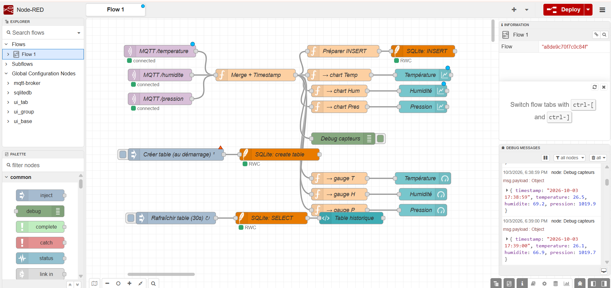
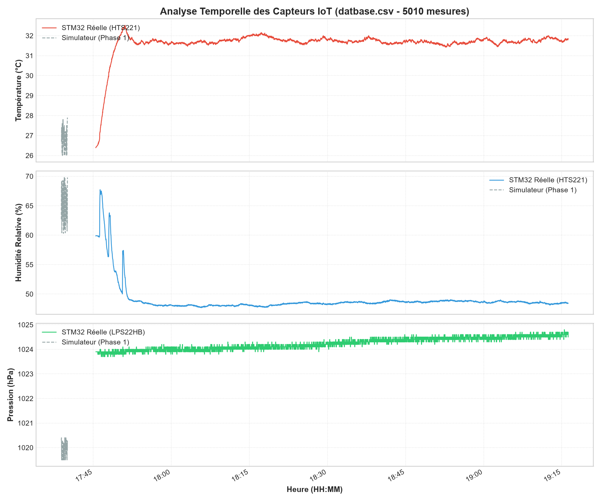
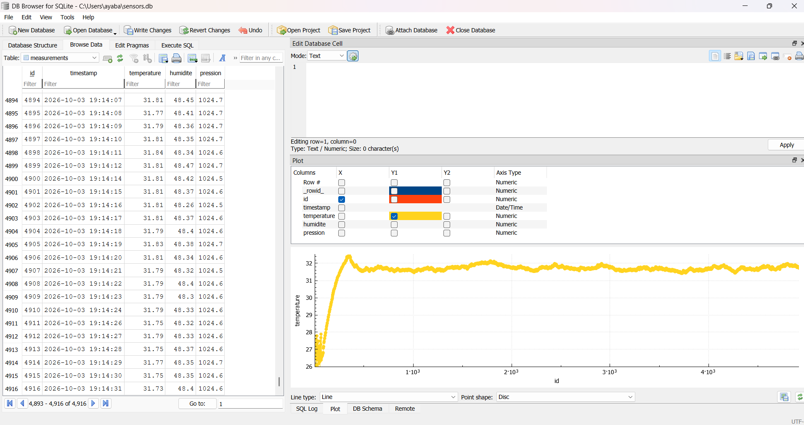

<p align="center">
  
</p>

<h1 align="center">STM32L475 IoT Telemetry & Node-RED Dashboard</h1>

<p align="center">
  <strong>Local Industrial Networks & IoT Systems (3GE)</strong><br/>
  ENIT - Ecole Nationale d'Ingenieurs de Tunis, Universite de Tunis El Manar
</p>

<p align="center">
  
  
  
  
  
  
  
</p>

---

## Overview

An end-to-end IoT telemetry pipeline built on the **B-L475E-IOT01A Discovery board**. The STM32 firmware reads onboard environmental and inertial sensors, connects to Wi-Fi, and publishes live measurements over MQTT. A **Node-RED** flow subscribes to the broker, renders a real-time dashboard with gauges and charts, and logs every sample into a **SQLite** time-series database. Python scripts provide offline statistical analysis and visualization.

| Layer | What it does |
|-------|-------------|
| **Edge** - STM32L475 | Reads 6 sensors, joins Wi-Fi, publishes MQTT packets every second |
| **Broker** - Mosquitto | Routes `/temperature`, `/humidite`, `/pression` topics |
| **Dashboard** - Node-RED | Live gauges, trend charts, historical table (port `1880/ui`) |
| **Storage** - SQLite | Persistent `measurements` table with timestamped records |
| **Analytics** - Python | Pandas + Matplotlib temporal plots and statistical reports |

---

## Table of Contents

- [System Architecture](#system-architecture)
- [Architecture & SQLite Persistence (Doc)](docs/ARCHITECTURE_ET_SQLITE.md)
- [Mobile Hotspot Setup & Offline Demo (Doc)](docs/SMARTPHONE_HOTSPOT_GUIDE.md)
- [Hardware & Sensors](#hardware--sensors)
- [Firmware Design](#firmware-design)
- [Node-RED Dashboard](#node-red-dashboard)
- [Data Analytics](#data-analytics)
- [Quickstart Guide](#quickstart-guide)
- [Repository Structure](#repository-structure)
- [Author](#author)

---

## System Architecture

```
+--------------------------------------------------------------+
|  EDGE NODE :  B-L475E-IOT01A   (ARM Cortex-M4 @ 80 MHz)     |
|                                                               |
|  HTS221 (T/H)   LPS22HB (P)   LSM6DSL (Accel/Gyro)          |
|       |  I2C         |  I2C        |  SPI3                   |
|       +------------- + ----------- + ---+                     |
|                   STM32 HAL Firmware                          |
|       50 ms loop :  shake detection  (|a|^2 > 1.5 g)         |
|     1000 ms loop :  T / H / P  -->  MQTT Publish             |
|                          |                                    |
|              Inventek ISM43362 Wi-Fi (SPI3)                   |
+--------------------------+------------------------------------+
                           |   802.11 b/g/n
                           v
+--------------------------------------------------------------+
|  LOCAL PC / GATEWAY                                           |
|                                                               |
|  Mosquitto MQTT Broker  (port 1883)                           |
|       |                                                       |
|  Node-RED  -->  Dashboard  (gauges + charts)                  |
|       |         SQLite     (sensors.db)                       |
|       v                                                       |
|  Python Analytics  (plot_sensors.py / analyse_database.py)    |
+--------------------------------------------------------------+
```

---

## Hardware & Sensors

**Board:** [B-L475E-IOT01A](https://www.st.com/en/evaluation-tools/b-l475e-iot01a.html) - STM32L475VGT6, 80 MHz, 1 MB Flash, 128 KB SRAM.

| Sensor | Measures | Interface | Key Specs |
|--------|----------|-----------|-----------|
| **HTS221** | Temperature + Humidity | I2C2 | -40 to +120 C, 0-100 % rH |
| **LPS22HB** | Barometric pressure | I2C2 | 260-1260 hPa, 0.05 hPa RMS |
| **LSM6DSL** | 3-axis Accel + 3-axis Gyro | SPI3 | +/-2/4/8/16 g, +/-125-2000 dps |
| **LIS3MDL** | 3-axis Magnetometer | I2C2 | +/-4 to +/-16 gauss |
| **ISM43362** | Wi-Fi 802.11 b/g/n | SPI3 | Integrated TCP/IP, AT commands |

---

## Firmware Design

Developed in **C** with **STM32CubeIDE** using the HAL and BSP libraries.

### Dual-Rate Loop

The main loop runs two concurrent tasks at different rates without an RTOS:

| Rate | Period | Task |
|------|--------|------|
| **Fast** | 50 ms (20 Hz) | Read accelerometer, compute magnitude, trigger shake event if > 1.5 g |
| **Slow** | 1000 ms (1 Hz) | Read T / H / P sensors, format and publish 3 MQTT messages |

```c
// --- Fast loop: shake detection (every 50 ms) ---
BSP_ACCELERO_AccGetXYZ(acc);
uint32_t magnitude_sq = ax*ax + ay*ay + az*az;
if (magnitude_sq > SHAKE_THRESHOLD)
    uart_print("*** SHAKE detected ***");

// --- Slow loop: telemetry (every 1 s) ---
if (++tick >= 20) {
    tick = 0;
    float temp  = BSP_TSENSOR_ReadTemp();
    float hum   = BSP_HSENSOR_ReadHumidity();
    float press = BSP_PSENSOR_ReadPressure();
    MQTT_Publish("/temperature", temp_str);
    MQTT_Publish("/humidite",    hum_str);
    MQTT_Publish("/pression",    press_str);
}
```

### Wi-Fi Connection

The Inventek ISM43362 module is driven over SPI3 through the `es_wifi` driver:

1. **Initialize** module - read firmware version and MAC address
2. **Scan** available access points (SSID, RSSI, encryption)
3. **Join** network with 3-attempt retry logic
4. **DHCP** - obtain IP, ping the default gateway
5. **Socket** - open TCP connection to Mosquitto broker on port 1883

### Lightweight MQTT Client

Instead of a full MQTT library, the firmware builds raw binary packets:

| Packet | Size | Contents |
|--------|------|----------|
| **CONNECT** | 23 bytes | Protocol name, level 4, clean session, 60 s keep-alive, client ID `stm32l475` |
| **PUBLISH** | Variable | Topic + payload, sent via `WIFI_SendData()` |

---

## Node-RED Dashboard

<p align="center">
  
</p>
<p align="center"><em>Node-RED flow: MQTT subscription - data merge - gauges + charts + SQLite storage</em></p>

The flow (`node-red/flows.json`) implements five stages:

| Stage | Node Type | Description |
|-------|-----------|-------------|
| 1 | `mqtt in` | Subscribe to `/temperature`, `/humidite`, `/pression` |
| 2 | `function` | Merge topics into a single timestamped object |
| 3 | `ui_gauge` + `ui_chart` | Real-time circular gauges and trend line charts |
| 4 | `sqlite` | Insert each reading into `measurements` table |
| 5 | `ui_template` | HTML table of last 50 records, auto-refreshed every 30 s |

### SQLite Schema

```sql
CREATE TABLE IF NOT EXISTS measurements (
    id          INTEGER PRIMARY KEY AUTOINCREMENT,
    timestamp   DATETIME DEFAULT CURRENT_TIMESTAMP,
    temperature REAL NOT NULL,
    humidite    REAL NOT NULL,
    pression    REAL NOT NULL
);
```

---

## Data Analytics

<p align="center">
  
</p>
<p align="center"><em>Multi-axis temporal analysis: temperature, humidity, and pressure recorded from the STM32 node</em></p>

The `tools/` directory includes Python scripts for offline data exploration:

| Script | Purpose |
|--------|---------|
| `plot_sensors.py` | Query SQLite and render 3-panel Matplotlib charts with time filtering |
| `analyse_database.py` | Statistical summary (mean, std, min, max) + phase comparison |
| `check_db.py` | Quick database health check |
| `simulate_stm32.ps1` | Publish fake MQTT telemetry to test without hardware |

### Sample Results

| Parameter | Mean | Min | Max | Std Dev |
|-----------|------|-----|-----|---------|
| Temperature (C) | 27.65 | 26.10 | 29.80 | +/- 0.62 |
| Humidity (% rH) | 64.80 | 58.20 | 71.40 | +/- 2.15 |
| Pressure (hPa) | 1018.4 | 1014.2 | 1022.1 | +/- 0.94 |

---

## Quickstart Guide

### 1. Start Mosquitto

```bash
mosquitto -c tools/mosquitto.conf -v
```

### 2. Start Node-RED

```bash
npm install node-red-dashboard node-red-node-sqlite
node-red
```

Open `http://localhost:1880`, import `node-red/flows.json`, click **Deploy**, then visit `http://localhost:1880/ui`.

### 3. Flash the STM32

1. Open **STM32CubeIDE** and import `firmware/` as an existing project.
2. Copy `wifi_credentials.example.h` to `wifi_credentials.h` and set your network credentials:

```c
#define WIFI_SSID     "Your_Network_SSID"
#define WIFI_PASSWORD "Your_Network_Password"
```

3. Build (`Ctrl+B`) and flash via **ST-LINK**.
4. Open a serial terminal at **115200 baud** (8N1) to see logs:

<p align="center">
  
</p>

### 4. Test Without Hardware

Use the included emulator to feed fake data into the full pipeline:

```powershell
cd tools
.\simulate_stm32.ps1 -Count 60 -DelaySec 1
```

Then visualize the captured data:

```bash
python tools/plot_sensors.py --last 30
```

---

## Repository Structure

```
stm32l475-iot-nodered/
|-- README.md
|-- LICENSE
|-- .gitignore
|-- docs/
|   |-- ARCHITECTURE_ET_SQLITE.md      System architecture & SQLite details
|   |-- SMARTPHONE_HOTSPOT_GUIDE.md    Autonomous mobile hotspot demo guide
|   +-- images/                        Screenshots and analysis graphs
|-- firmware/
|   |-- Core/
|   |   |-- Inc/                   Headers (main.h, wifi_credentials.example.h)
|   |   |-- Src/                   Source (main.c = core firmware)
|   |   +-- Startup/               Startup assembly
|   |-- Drivers/
|   |   |-- BSP/                   Board support (HTS221, LPS22HB, LSM6DSL, LIS3MDL)
|   |   +-- WiFi/                  Inventek ISM43362 driver
|   |-- RL.ioc                     STM32CubeMX pin configuration
|   +-- STM32L475VGTX_FLASH.ld    Linker script
|-- node-red/
|   +-- flows.json                 Importable Node-RED flow
+-- tools/
    |-- requirements.txt           Python dependencies
    |-- mosquitto.conf             Broker configuration
    |-- simulate_stm32.ps1        MQTT telemetry emulator
    |-- plot_sensors.py           SQLite viewer + Matplotlib plots
    |-- analyse_database.py       Statistical analysis (Pandas)
    |-- check_db.py               Database health check
    +-- sample_measurements.csv   Real captured dataset
```

> **Security Notice:** `wifi_credentials.h` (containing real passwords) is excluded by `.gitignore`. Only the sanitized template `wifi_credentials.example.h` is committed.

---

## Author

**Eya Badri**
- Engineering student - Genie Electrique (3GE)
- **Ecole Nationale d'Ingenieurs de Tunis (ENIT)** - Universite de Tunis El Manar
- Email: [eya.badri@etudiant-enit.utm.tn](mailto:eya.badri@etudiant-enit.utm.tn)
- GitHub: [github.com/eyabadri](https://github.com/eyabadri)

---

## License

Released under the **MIT License (Modified for Showcase)**. See [LICENSE](LICENSE).

(c) 2026 Eya Badri - All Rights Reserved.
